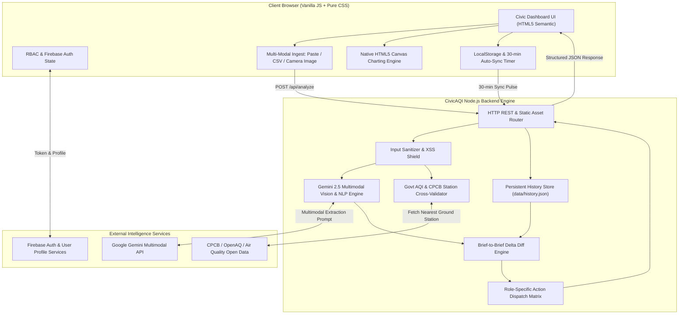

# System & UI/UX Design Document (DESIGN.md)
## Project Name: CivicAQI — AI-Driven Civic Intelligence Platform
**Version:** 1.0.0  
**Stack Architecture:** Pure Vanilla Web Stack (HTML5, CSS3, ES6+ JavaScript, Native Node.js). Zero CSS frameworks.

---

### 1. System Architecture & Component Interaction Flow



---

### 2. UI/UX Layout Wireframe & Design System

#### 2.1 Screen Anatomy (Responsive Mobile-to-Desktop)

```
+-----------------------------------------------------------------------------------------+
| [LOGO: CivicAQI]  Ward 12, Pincode 110085  | Role: [Ward Officer v]  | [Sync: 12m ago (⟳)]|
+-----------------------------------------------------------------------------------------+
|                                    MAIN NAVIGATION BAR                                  |
| [1. Ingest & Analyze]    [2. Action Dashboard]    [3. Hotspot Map]    [4. History & Logs]|
+-----------------------------------------------------------------------------------------+
| +-----------------------------------------------+ +------------------------------------+ |
| | MULTI-INPUT INGESTION PANEL                   | | LIVE VERIFIED GOVERNMENT BENCHMARK | |
| | [Text/Table] [Upload CSV] [Photo/Camera]      | | Station: Rohini Sec 16 (CPCB)       | |
| | +-------------------------------------------+ | | AQI: 388 (Very Poor) | Delta: +7   | |
| | | Paste messy tables, regional statements,  | | | PM2.5: 242 µg/m³   | NO2: 64 ppb   | |
| | | or drop monitor screenshots here...       | | +------------------------------------+ |
| | +-------------------------------------------+ | | EXECUTIVE BRIEF (200-300 Words)    | |
| | Pincode: [110085] Role: [Ward Officer v]    | | "Air quality across Rohini has       | |
| | Language: [Hindi v] [ANALYZE NOW (AI)]      | | reached severe thresholds..."        | |
| +-----------------------------------------------+ +------------------------------------+ |
+-----------------------------------------------------------------------------------------+
| +-----------------------------------------------+ +------------------------------------+ |
| | NATIVE 24H TREND & POLLUTANT SPREAD (Canvas) | | HOTSPOT & PINCODE MATRIX           | |
| | [ Line Chart: PM2.5 / PM10 / AQI Curves ]    | | [110085: 412] [110086: 375] [110034]| |
| | [ Bar Chart: Pollutant vs Safe WHO Limits ]   | | Status: Sector 9 Resuspension      | |
| +-----------------------------------------------+ +------------------------------------+ |
+-----------------------------------------------------------------------------------------+
| +-----------------------------------------------+ +------------------------------------+ |
| | BRIEF-TO-BRIEF DELTA COMPARISON               | | PRIORITIZED ROLE-BASED ACTIONS     | |
| | Previous AQI: 360  ->  Current AQI: 395 (+35) | | P0 [Immediate 1h]: Anti-smog spray | |
| | Trend: 🔺 WORSENING (+9.7% spike)             | | P1 [Operational]: Stop-work order  | |
| | Key Shift: Morning traffic surge at Junction  | | [Assign Action] [Escalate to Admin]| |
| +-----------------------------------------------+ +------------------------------------+ |
+-----------------------------------------------------------------------------------------+
| +-----------------------------------------------+ +------------------------------------+ |
| | TARGETED CITIZEN HEALTH ADVISORIES            | | CIVIC ESCALATION & CONTACT DESK    | |
| | • Children: Suspend outdoor play & assemblies| | Authority: DPCC & Junior Engineer  | |
| | • Older Adults: Keep windows sealed, purifiers| | Phone: +91-11-23860360             | |
| | • Commercial: Inspect DG filters & haulers   | | [Draft Pre-filled Escalation Memo] | |
| +-----------------------------------------------+ +------------------------------------+ |
+-----------------------------------------------------------------------------------------+
```

---

### 3. Responsive Units & Styling Architecture

To strictly obey the design guidelines without frameworks:
1. **Typography & Spacing Scale**:
   - `html { font-size: clamp(14px, 1.1vw, 17px); }`
   - Spacing: `--space-xs: 0.25rem; --space-sm: 0.5rem; --space-md: 1rem; --space-lg: 1.5rem; --space-xl: 2.25rem;`
2. **Container Boundaries**:
   - Container Max Width: `min(94vw, 1380px)`
   - Grid Layout: `grid-template-columns: repeat(auto-fit, minmax(min(100%, 28rem), 1fr));`
3. **Fluid Media Elements**:
   - Canvas Displays: `width: 100%; height: clamp(220px, 32vh, 380px);`
4. **Color Tokens**:
   - Background Canvas: `--bg-main: #090d16;`
   - Surface Cards: `--surface-card: #131b2e;`
   - Border Subdued: `--border-subtle: #232f48;`
   - Primary Accent: `--civic-blue: #3b82f6;`
   - Severity Hazard: `--aqi-severe: #ef4444; --aqi-hazardous: #881337;`

---

### 4. Brief-to-Brief Delta Comparison Engine

The delta comparison algorithm compares the current state $S_t$ against the immediate past recorded state $S_{t-1}$:

$$\Delta AQI = AQI_t - AQI_{t-1}$$
$$\% \Delta = \left( \frac{\Delta AQI}{AQI_{t-1}} \right) \times 100$$

Categorization Logic:
* If $\Delta AQI \ge +20$: **Critical Deterioration** (Color: Red, Alert level: Severe).
* If $+5 \le \Delta AQI < +20$: **Moderate Increase** (Color: Amber).
* If $-5 < \Delta AQI < +5$: **Stable / Plateauing** (Color: Slate).
* If $\Delta AQI \le -20$: **Significant Improvement** (Color: Emerald).

---

### 5. Role-Based Action Matrix & Dispatch Workflow

```
[User Action Request]
        │
   [Check Role]
   ├── Super Admin: Can dispatch official orders to any ward, reassign field units, lock reports.
   ├── Ward Officer: Can dispatch water misting units, file formal environmental violations.
   ├── Housing Society (RWA): Can enforce generator bans, mandate dust barriers inside residential bounds.
   ├── School Authority: Can order sports cancellations and indoor recess.
   └── Citizen: Can submit verified geo-tagged grievance tickets with photo proof.
```

---

### 6. Escalation Memo Generator
When a citizen or RWA encounters a hazardous hotspot exceeding standard municipal thresholds:
* The system auto-populates a standardized **Notice of Hazardous Air Quality** addressed to:
  - Sub-Divisional Magistrate (SDM)
  - Municipal Ward Junior Engineer (Civil & Sanitation)
  - State Pollution Control Board Nodal Officer
* Contains exact coordinates, timestamp, verified station delta, and recommended enforcement provisions under Section 133 of CrPC / Environmental Protection Act.
